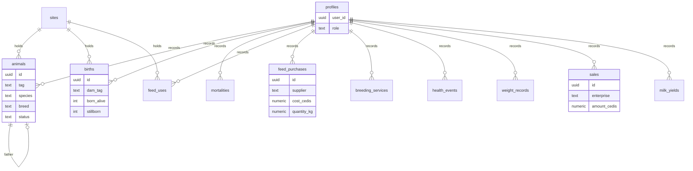

# Katamansu Spice Farm

Katamansu Spice Farm is the livestock app for the commercial farm at Shai Hills, Ghana.

The farm today: about 1,000 pigs (60% growers, 38% sows, 2% boars), about 100 cattle (Sokoto Gudali, Sanga, West African Shorthorn), about 20 goats, and poultry housing for 1,000 birds or 2,000 if every pen is used. The land is about 20 acres. Work happens at two sites about 7 km apart: Piggery Site, and Cattle/Poultry Site. Dairy cattle, Friesian, Jersey, and Girolando crosses, and meat and dairy processing are the growth path toward $250,000–$300,000 a year.

The phone app is for people who do not live in software. Big buttons, a phone number, a text code, and almost no typing.

## What is in the app now

Home shows the herd, then Farm, Piggery, Cattle, Birds, Jobs, and Feed. The piggery donut, cattle breeds, poultry housing, jobs that are due, and feed still on hand are on those boards. Tap a revenue bar or a breed to open the rows behind it. Today records births, deaths, feed, breeding, weights, health, and milk. Money records expenses and sales. A receipt photo can be taken or chosen; if `GEMINI_API_KEY` is set, the supplier and amount are filled in for the person to check. Animals is the register, with search, and the first 40 tags on screen so a 1,000-pig herd stays usable. Records save on the phone and sync when Supabase is connected.

Due work is on the Jobs board. Push notifications wait until a Firebase project exists, because adding that package without its config stops the Android build.

## Still planned

- Azure Document Intelligence as a second reader beside Gemini.
- Firebase Cloud Messaging once a Firebase project exists.
- Week and custom date ranges on every chart. The boards currently use this month, which is the period the farm checks each morning.

## Layers

```text
lib/domain     animals, roles, ledger, KPI maths. No Flutter.
lib/data       on-phone store, Supabase, sync
lib/state      controllers the screens listen to
lib/ui         screens and shared widgets
lib/app        wires a backend into the app
```

Screens talk to controllers. Controllers talk to repositories. Repositories talk to the phone or to Supabase. The KPI maths in `lib/domain/kpis.dart` does not know which one it is.

Shared widgets already in the app: `FarmFrame`, `NoticeBanner`, `LoadingView`, `ErrorView`, and the species colours in `species_style.dart`.

## Feature map

| Feature | Where it lives |
| --- | --- |
| Sign-in | `domain/phone.dart`, `data/local_auth_repository.dart`, `ui/sign_in_screen.dart` |
| People and roles | `domain/role.dart`, `ui/people_screen.dart` |
| Animals | `domain/animal.dart`, `ui/registry_screen.dart`, `ui/animal_form_screen.dart` |
| Today (birth, death, feed) | `ui/today_screen.dart`, `domain/ledger.dart` |
| Breeding, weight, health, sales, milk | same ledger and Today screen |
| Dashboard and KPIs | `ui/dashboard_screen.dart`, `domain/kpis.dart` |
| Notebook | `domain/farm_entry.dart`, `ui/book_screen.dart` |
| Offline sync | `data/local_ledger_repository.dart`, `domain/sync_target.dart` |

## Roles

| | Admin | Farm manager | Farm worker |
| --- | --- | --- | --- |
| People and roles | Yes | No | No |
| Money, feed cost, sales | Yes | Yes | No |
| Animals, breeding, feed purchases, weights | Yes | Yes | No |
| Births, deaths, feed used | Yes | Yes | Yes |
| Herd counts and due alerts | Yes | Yes | Yes |

The practice number `024 412 0008` with code `123456` is the admin. A new number joins as a worker. The admin opens **People** and can make that person a manager. The farm always keeps one admin.

Supabase stores the role on `profiles`. Row level security repeats the same rules, so a worker cannot read `sales` or `feed_purchases` even if the app is bypassed.

## Authentication

Supabase Auth, phone one-time code. There is no password.

1. The person enters a Ghana number (`024…`, `+233…`, or `233…`).
2. `signInWithOtp` sends the text when Supabase and an SMS provider are connected.
3. `verifyOTP` with `OtpType.sms` opens the session.
4. The app reads `profiles.role`.

On a phone with no Supabase project, the same screens run against a local store. The code is shown on the screen because no text can be sent. The practice code is always `123456`.

## Offline sync

Workers record births, deaths, and feed while the network is down.

1. The record is written on the phone immediately and the dashboard can use it.
2. It is marked pending.
3. `flush` sends pending rows to Supabase in order.
4. A row stays pending if the server rejects it. Rows already accepted are marked synced.
5. Opening the app tries again. **Sync now** tries again from the Today page.

The on-phone copy is the source until the server accepts the row. Animals and the notebook are shared on that phone for every account. With Supabase, they are one herd for every signed-in person, enforced by row level security.

## State

`ChangeNotifier` controllers: `AuthController`, `HerdController`, `BookController`, `LedgerController`. A screen rebuilds when its controller notifies. No separate state-management package. The farm's state is small enough to see in those four objects.

## API

The app does not add a second HTTP API. Supabase PostgREST is the API. The phone calls it through the repositories.

| Table | Who writes | Used for |
| --- | --- | --- |
| `profiles` | trigger on sign-up, admin updates | role |
| `sites` | SQL seed | Piggery Site, Cattle/Poultry Site |
| `animals` | managers | register |
| `farm_entries` | workers except sales | notebook |
| `births` | everyone | litters |
| `mortalities` | everyone | deaths |
| `feed_uses` | everyone | feed consumed |
| `feed_purchases` | managers | feed cost |
| `breeding_services` | managers | service, expected farrowing and calving |
| `health_events` | managers | vaccines and due dates |
| `weight_records` | managers | average daily gain |
| `sales` | managers | revenue |
| `milk_yields` | managers | litres per cow |
| `land_parcels` | SQL seed | pasture, maize, soybean, napier, fallow |
| `device_tokens` | the signed-in phone | future push |

Files (vet papers, animal photos) go in the private Storage bucket `farm-files`. Managers can upload. Everyone signed in can read.

## KPI rules

Calculated in `FarmKpis.evaluate` for the current month unless noted.

- **Revenue** is the sum of sales.
- **Feed cost** is the sum of feed purchases.
- **After feed** is revenue minus feed cost. This is the margin the farm can see before other costs.
- **Feed cost ratio** is feed cost divided by revenue.
- **Best enterprise** gets the sales for that enterprise minus its share of feed cost. Cattle feed is charged to beef or dairy, whichever brought in more money that month, so the same feed is not charged twice.
- **Piglets per litter** is the average born alive on birth records.
- **Weaning rate** is weaned divided by born alive on service records that have a weaned count.
- **Farrowing rate** is served sows that also have a birth record, divided by served sows.
- **Sow score** is piglets born alive per litter. The top of that list is the most productive sow.
- **Cattle gain** is (last weight − first weight) / days. Under 0.5 kg a day is called out.
- **Litres per cow** is milk litres divided by the number of cows recorded.
- **Poultry FCR** is poultry feed kilograms divided by kilograms gained.
- **Mortality** is deaths this month divided by animals still on the farm plus those deaths.
- **Attention** lists vaccines due within 7 days, and services whose expected farrowing or calving is within 7 days. Pig gestation is 114 days. Cattle gestation is 283 days.

## Notifications

Due items are calculated on the phone and shown on Home. When Firebase is connected, store the device token in `device_tokens` and send a Firebase Cloud Messaging message for the same due list from a Supabase scheduled function. The app does not ship a Firebase project yet, so it does not pretend a push was sent.

## Wireframes

Home, phone width:

```text
Katamansu Spice Farm
024 412 0008
Admin

On the farm
[ Pigs ] [ Cattle ]
[ Goats ] [ Poultry ]

This month
Today
Needs attention
```

Today:

```text
[ Birth        ]
[ Death        ]
[ Feed used    ]
[ Feed bought  ]  manager
[ Service      ]  manager
[ Weigh-in     ]  manager
[ Vaccine      ]  manager
[ Sale         ]  manager
```

Birth asks for a tag, species chips, born alive, stillborn, and Main yard or North pasture.

Animals is the register. Book is the short notebook. Workers do not see sale amounts.

## Tests

`flutter test` covers the KPI maths, the offline queue, roles, the shared herd, and the birth button. `.github/workflows/check.yml` runs analyze and test on each push.

## Deployment

Android is the phone people will hold. The web app is the second install, added to the home screen. iOS uses the same project when that build is needed.

1. Create a Supabase project. Turn on the Phone provider and an SMS provider.
2. Run the SQL files in `supabase/migrations` in filename order.
3. Copy `env.example.json` to `env.json` and fill in the URL and anon key.
4. `flutter build apk --dart-define-from-file=env.json` for Android.
5. `flutter build web --dart-define-from-file=env.json` and serve `build/web` over HTTPS for the installable site.
6. `flutter build ios --dart-define-from-file=env.json` when an iPhone build is required.

Without `env.json`, the app keeps records on that device and the practice admin still signs in.

## ERD


